Fitting Linear Models
================

- [The R You Need](#the-r-you-need)
- [The Data](#the-data)
- [1. One Continuous Predictor: Weight and Height](#1-one-continuous-predictor-weight-and-height)
- [2. How Much Does Height Help? R²](#2-how-much-does-height-help-r²)
- [3. The Fitted Model as a Generative Model](#3-the-fitted-model-as-a-generative-model)
  - [Mode 1: The Line](#mode-1-the-line)
  - [Mode 2: One Simulated Data Set](#mode-2-one-simulated-data-set)
  - [Mode 3: All Possible Data](#mode-3-all-possible-data)
- [4. Two Predictors: Height and Age](#4-two-predictors-height-and-age)
- [5. Correlation Is a Linear Model](#5-correlation-is-a-linear-model)
- [Reference](#reference)

## The R You Need

This file contains a lot of code, but most of it only draws figures and simulates data to explain what the model means. To fit a linear model yourself, you need three commands:

- **`read.csv()`:** reads a data file into a data frame. It expects a CSV file (comma-separated values): plain text with one row per observation (here, one person) and one column per variable. The values in a row are separated by commas, and the first row holds the column names. These names are what you use in the `lm()` formula. Excel can save a sheet in this format (*File \> Save As \> CSV*).
- **`lm()`:** fits the linear model. The formula names the outcome left of `~` and the predictors right of it, joined with `+`.
- **`summary()`:** prints the fitted parameters (and more).

A minimal example, with the data used below:

``` r
body <- read.csv("data/body.csv")
fit <- lm(Weight ~ Height, data = body)
summary(fit)
```

Section 1 runs exactly these lines and explains the output. For two predictors, only the formula changes: `lm(Weight ~ Height + Age, data = body)`.

The path `"data/body.csv"` is relative to R’s working directory. For more on file paths and the working directory, see this [tutorial on reading CSV files](https://learn-r.org/r-tutorial/read-csv.php).

You do not need to be able to write the plotting and simulation code in the rest of this file. Read it to see what it does, but do not worry about the details.

## The Data

Body measurements of 507 physically active adults (Heinz et al., 2003). We use three columns: weight (kg), height (cm), and age (years).

``` r
body <- read.csv("data/body.csv")

head(body[, c("Weight", "Height", "Age")])
#>   Weight Height Age
#> 1   65.6  174.0  21
#> 2   71.8  175.3  23
#> 3   80.7  193.5  28
#> 4   72.6  186.5  23
#> 5   78.8  187.2  22
#> 6   74.8  181.5  21
nrow(body)
#> [1] 507
```

## 1. One Continuous Predictor: Weight and Height

The model:

$$\mathrm{weight}_i = \beta_0 + \beta_1 \times \mathrm{height}_i + \epsilon_i, \qquad \epsilon_i \sim N(0, \sigma^2)$$

``` r
plot(body$Height, body$Weight, xlab = "height (cm)", ylab = "weight (kg)", col = "grey40")
```

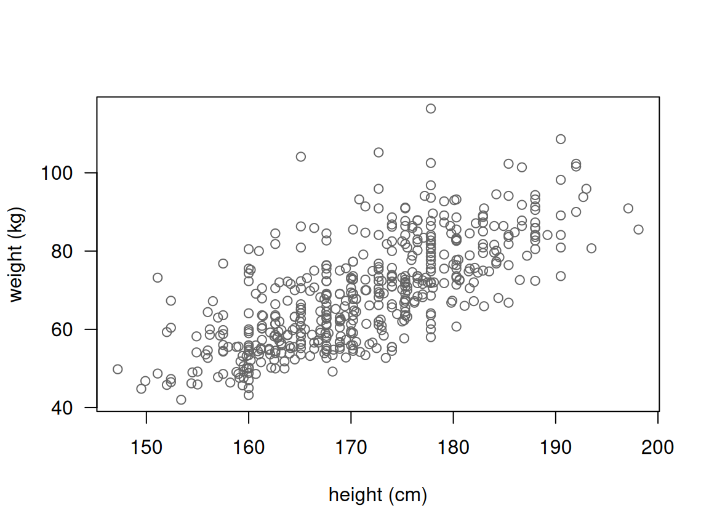

`lm()` finds the least-squares values of $\beta_0$ and $\beta_1$. The formula `Weight ~ Height` reads “weight, predicted by height”. The intercept is included automatically.

``` r
fit <- lm(Weight ~ Height, data = body)
summary(fit)
#> 
#> Call:
#> lm(formula = Weight ~ Height, data = body)
#> 
#> Residuals:
#>     Min      1Q  Median      3Q     Max 
#> -18.743  -6.402  -1.231   5.059  41.103 
#> 
#> Coefficients:
#>               Estimate Std. Error t value Pr(>|t|)    
#> (Intercept) -105.01125    7.53941  -13.93   <2e-16 ***
#> Height         1.01762    0.04399   23.14   <2e-16 ***
#> ---
#> Signif. codes:  0 '***' 0.001 '**' 0.01 '*' 0.05 '.' 0.1 ' ' 1
#> 
#> Residual standard error: 9.308 on 505 degrees of freedom
#> Multiple R-squared:  0.5145, Adjusted R-squared:  0.5136 
#> F-statistic: 535.2 on 1 and 505 DF,  p-value: < 2.2e-16
```

> [!NOTE]
> The three parameters are in two places in this output:
>
> - **$\hat\beta_0$ and $\hat\beta_1$:** under `Coefficients:`, in the `Estimate` column. The row `(Intercept)` is $\hat\beta_0$ (-105), the row `Height` is $\hat\beta_1$ (1.02).
> - **$\hat\sigma$:** the line `Residual standard error:`, below the coefficients table (9.3). The “degrees of freedom” next to it are $n - 2$: the 507 people minus the two fitted $\beta$’s.

The rest of the output is for later: hypothesis testing and model comparison. That is the `Residuals:` block at the top, the columns `Std. Error`, `t value` and `Pr(>|t|)` of the coefficients table, and the lines `Adjusted R-squared:` and `F-statistic:` at the bottom. The `Multiple R-squared:` gets its own section below. The parameters can also be pulled out of the fit directly:

``` r
coef(fit)     # beta_0 and beta_1
#> (Intercept)      Height 
#> -105.011254    1.017617
sigma(fit)    # sigma
#> [1] 9.30804
```

The rest of this file uses them often, so we store them under short names:

``` r
b0 <- unname(coef(fit)[1])
b1 <- unname(coef(fit)[2])
s <- sigma(fit)
```

With these values filled in, the fitted model is:

$$\mathrm{weight}_i = -105 + 1.02 \times \mathrm{height}_i + \epsilon_i, \qquad \epsilon_i \sim N(0, 9.3^2)$$

``` r
plot(body$Height, body$Weight, xlab = "height (cm)", ylab = "weight (kg)", col = "grey40")
abline(fit, col = "red", lwd = 2)
```

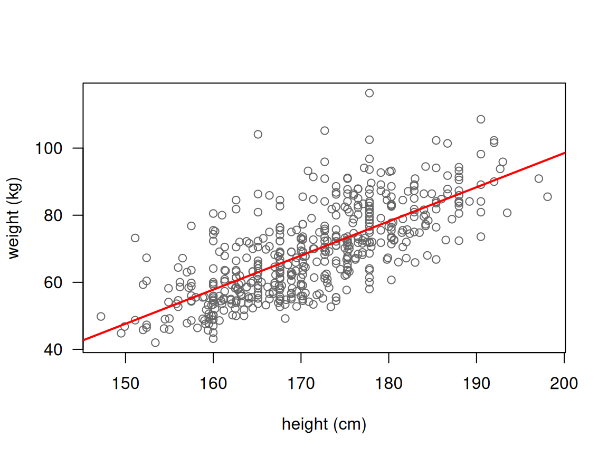

What the three numbers mean:

- **$\hat\beta_1$ (slope):** each extra cm of height adds about 1.02 kg to the predicted weight.
- **$\hat\beta_0$ (intercept):** the predicted weight at height 0. Here that is -105 kg, which is nonsense: nobody is 0 cm tall. The intercept is where the line crosses x = 0, even when that is far outside the data.
- **$\hat\sigma$:** the typical distance of a person from the line, about 9.3 kg.

The intercept, made visible by extending the axes to height 0:

``` r
plot(body$Height, body$Weight, xlab = "height (cm)", ylab = "weight (kg)", col = "grey40", xlim = c(0, 200), ylim = c(-110, 120))
abline(fit, col = "red", lwd = 2)
abline(h = 0, v = 0, lty = 2)
points(0, b0, pch = 19, col = "red", cex = 1.5)
```

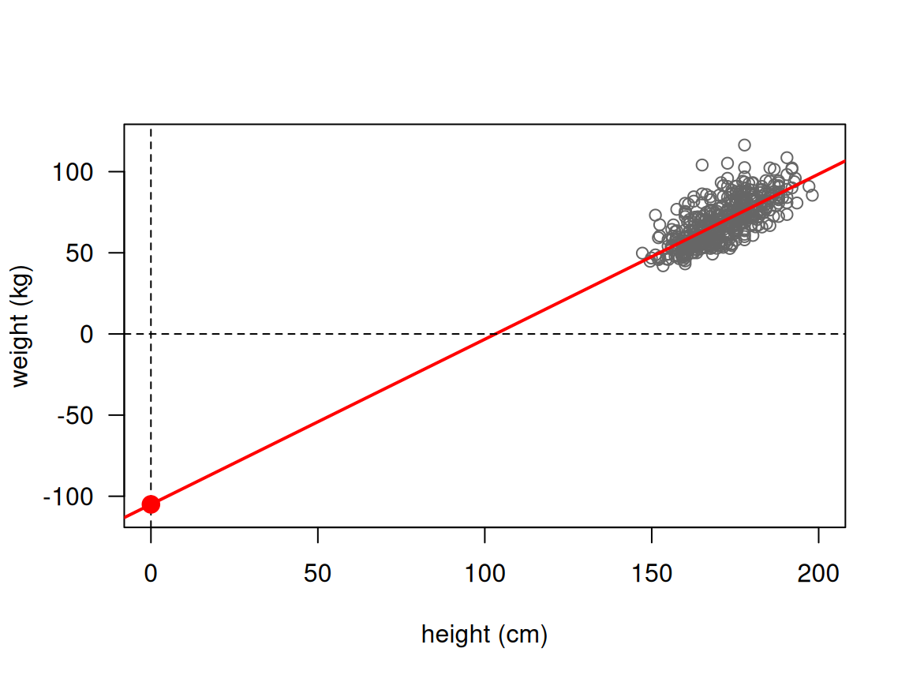

If the errors are normal, about 95% of people should lie within $2\hat\sigma$ of the line:

``` r
mean(abs(residuals(fit)) < 2 * s)
#> [1] 0.9566075
```

The model assumes the errors are normal with mean 0 and sd $\sigma$. The residuals are our estimates of the errors, so we can compare their distribution with that assumption:

``` r
hist(residuals(fit), breaks = 30, freq = FALSE, main = "", xlab = "residual (kg)", col = "grey85", border = "white")
curve(dnorm(x, mean = 0, sd = s), add = TRUE, col = "orange", lwd = 2)

# sigma-hat: from 0 to one sd, drawn where the curve bends (at one sd)
y_s <- dnorm(s, mean = 0, sd = s)
arrows(0, y_s, s, y_s, code = 3, length = 0.08, lwd = 2)
text(s, y_s, bquote(hat(sigma) == .(round(s, 1)) ~ kg), pos = 4)
```

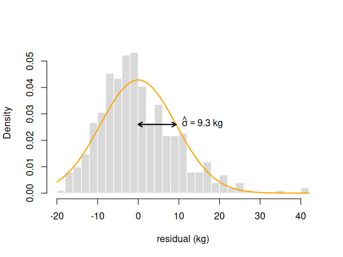

The histogram is the residuals; the orange curve is the normal distribution the model assumes, with sd $\hat\sigma$. They roughly agree, but the residuals are skewed: a long tail of people much heavier than the line predicts, and too few much lighter.

## 2. How Much Does Height Help? R²

The textbook definition: R² is the proportion of the variance in the outcome that is explained by the model. Here, the proportion of the variance in weight that is explained by height. That is short, but abstract. This section unpacks what it means.

Suppose you had to guess the weight of each person. Without knowing their height, the best single guess is the mean weight, 69 kg, for everyone. With height, you can use the line. R² compares these two ways of guessing.

The first way is also a linear model: one with an intercept and no predictor. In a formula, `1` stands for the intercept:

``` r
fit_mean <- lm(Weight ~ 1, data = body)    # everyone gets the mean weight
coef(fit_mean)
#> (Intercept) 
#>    69.14753

par(mfrow = c(1, 2))
plot(body$Height, body$Weight, type = "n", main = "Without height: the mean", xlab = "height (cm)", ylab = "weight (kg)", ylim = c(30, 130))
segments(body$Height, fitted(fit_mean), body$Height, body$Weight, col = "grey80")
points(body$Height, body$Weight, col = "grey40")
abline(h = coef(fit_mean), col = "red", lwd = 2)

plot(body$Height, body$Weight, type = "n", main = "With height: the line", xlab = "height (cm)", ylab = "weight (kg)", ylim = c(30, 130))
segments(body$Height, fitted(fit), body$Height, body$Weight, col = "grey80")
points(body$Height, body$Weight, col = "grey40")
abline(fit, col = "red", lwd = 2)
```

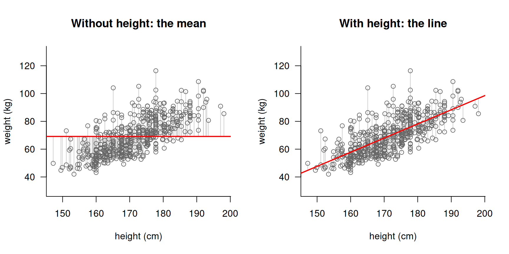

``` r
par(mfrow = c(1, 1))
```

The grey lines are the errors of each guess: the residuals of each model. On the right they are shorter. Their typical size is $\hat\sigma$ of each model:

``` r
sigma(fit_mean)    # without height: this is the sd of weight
#> [1] 13.34576
sigma(fit)         # with height
#> [1] 9.30804
```

R² measures how much smaller the errors became. It squares the residuals of each model and adds them up:

``` r
ss_mean <- sum(residuals(fit_mean)^2)    # without height
ss_line <- sum(residuals(fit)^2)         # with height
ss_mean
#> [1] 90123.34
ss_line
#> [1] 43753.01
```

These sums of squares are where $\hat\sigma$ comes from: divide by the degrees of freedom and take the square root. The model with height has $n - 2$ degrees of freedom, as in section 1. The model without height fits only one $\beta$, so it has $n - 1$:

``` r
sqrt(ss_mean / (nrow(body) - 1))         # the same as sigma(fit_mean)
#> [1] 13.34576
sqrt(ss_line / (nrow(body) - 2))         # the same as sigma(fit)
#> [1] 9.30804
```

So $\hat\sigma$ and the sum of squares measure the same thing: how far the people are from the model’s prediction. R² compares the two sums of squares. Their ratio is the share of the squared error that is left after using height. R² is the share that is gone:

$$R^2 = 1 - \frac{SS_\mathrm{line}}{SS_\mathrm{mean}}$$

``` r
ss_line / ss_mean                        # the share that is left
#> [1] 0.4854792
r_squared <- 1 - ss_line / ss_mean       # the share that is gone
r_squared
#> [1] 0.5145208
summary(fit)$r.squared                   # the same, from the summary
#> [1] 0.5145208
```

This is the `Multiple R-squared` in the `summary()` output: knowing height removes about 51% of the squared error. That is what “the proportion of the variance explained” means.

> [!NOTE]
> The typical error shrinks from 13.3 to 9.3 kg, which is only about 30% smaller. Yet R² says 51%. The difference is the squaring: $(9.3 / 13.3)^2 = 0.49$ is the share that is left.

R² compares the model with height to the model without it. Comparing models like this comes back later in the course.

## 3. The Fitted Model as a Generative Model

The fitted model gives values for all three parameters so that it can generate data. As on the slides, it can do so in three ways.

### Mode 1: The Line

$$\mu_i = \hat\beta_0 + \hat\beta_1 \times \mathrm{height}_i = -105 + 1.02 \times \mathrm{height}_i$$

The line gives the *mean* weight of people of a given height. For a 180 cm person:

``` r
b0 + b1 * 180
#> [1] 78.15977

plot(body$Height, body$Weight, type = "n", xlab = "height (cm)", ylab = "weight (kg)", ylim = c(30, 130), main = "1. The line")
abline(b0, b1, lwd = 2)
```

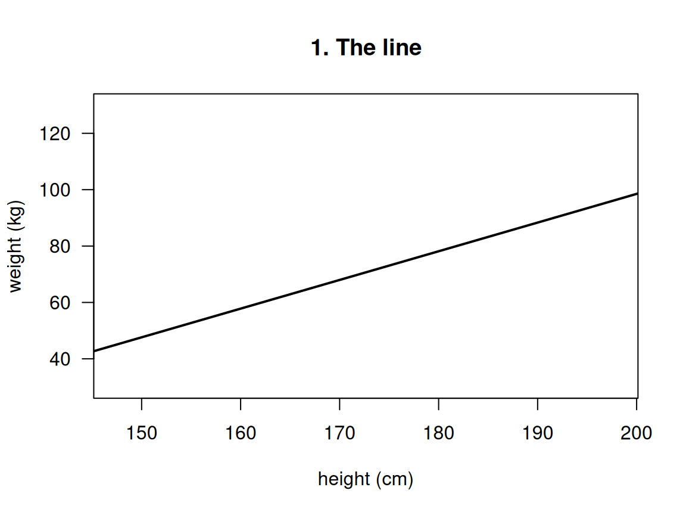

### Mode 2: One Simulated Data Set

$$\mathrm{weight}_i = -105 + 1.02 \times \mathrm{height}_i + \epsilon_i, \qquad \epsilon_i \sim N(0, 9.3^2)$$

Same heights, new weights: the line plus normal noise with sd $\hat\sigma$.

``` r
set.seed(1)
sim_weight <- b0 + b1 * body$Height + rnorm(nrow(body), 0, s)

par(mfrow = c(1, 2))
plot(body$Height, body$Weight, main = "Observed", xlab = "height (cm)", ylab = "weight (kg)", col = "grey40", ylim = c(30, 130))
plot(body$Height, sim_weight, main = "2. One simulated data set", xlab = "height (cm)", ylab = "weight (kg)", col = "orange", ylim = c(30, 130))
abline(b0, b1, lty = 2)
```

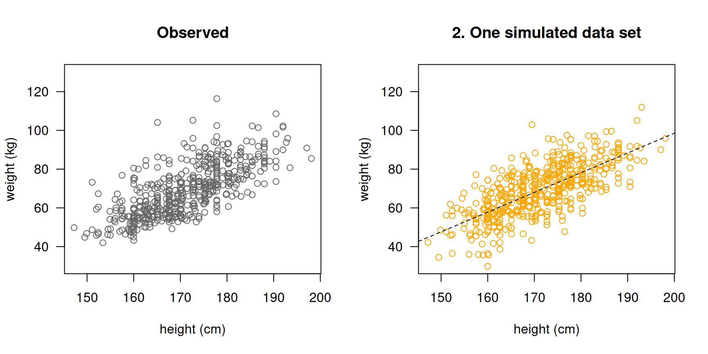

``` r
par(mfrow = c(1, 1))
```

Does the simulated data look like the observed data? Where does it differ?

Nothing in the model stops us from feeding it heights we never measured. Here are 200 people with heights from 50 to 250 cm:

``` r
set.seed(1)
new_height <- runif(200, 50, 250)
new_weight <- b0 + b1 * new_height + rnorm(200, 0, s)

plot(new_height, new_weight, type = "n", xlab = "height (cm)", ylab = "weight (kg)")
rect(min(body$Height), -1000, max(body$Height), 1000, col = adjustcolor("grey", 0.3), border = NA)
points(new_height, new_weight, col = "orange")
abline(b0, b1, lty = 2)
abline(h = 0, lty = 3)
```

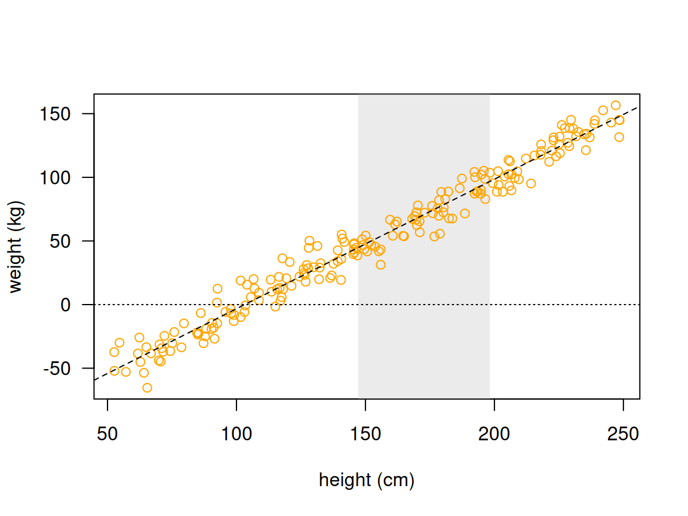

> [!WARNING]
> The grey strip is the range of heights in the data. Outside it, the model keeps generating weights, and below about 103 cm they become negative. The model is only as good as the data it was fitted to: it knows nothing about babies or giants.

Now zoom in on one person. Take someone who is 180 cm tall, and let the model generate many other people of exactly that height:

``` r
i <- which.min(abs(body$Height - 180))   # the person closest to 180 cm
body[i, c("Weight", "Height")]
#>    Weight Height
#> 11   76.6    180

set.seed(1)
same_height <- b0 + b1 * body$Height[i] + rnorm(5000, 0, s)

par(mfrow = c(1, 2))
plot(body$Height, body$Weight, main = "One person, and others of the same height", xlab = "height (cm)", ylab = "weight (kg)", col = "grey70", ylim = c(30, 130))
abline(b0, b1, lty = 2)
points(rep(body$Height[i], 150), same_height[1:150], pch = "-", cex = 2, col = adjustcolor("orange", 0.5))
points(body$Height[i], body$Weight[i], pch = 19, cex = 1.5)

hist(same_height, breaks = 40, freq = FALSE, main = "All people who are 180 cm tall", xlab = "weight (kg)", col = "grey85", border = "white")
curve(dnorm(x, mean = b0 + b1 * body$Height[i], sd = s), add = TRUE, col = "orange", lwd = 2)
abline(v = body$Weight[i], lwd = 2)
```

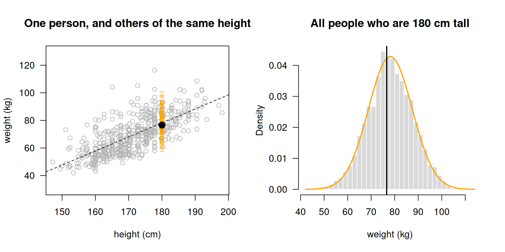

``` r
par(mfrow = c(1, 1))
```

On the left, the orange dashes are 150 people the model generates at this height: the people we could have measured instead. On the right, 5000 of them as a histogram. The black line is the person we did measure: one draw from this distribution. Its shape is the normal curve $N(\hat\beta_0 + \hat\beta_1 \times 180,\ \hat\sigma^2)$, and that curve, at every height at once, is mode 3.

### Mode 3: All Possible Data

$$\mathrm{weight}_i \sim N(-105 + 1.02 \times \mathrm{height}_i,\ 9.3^2)$$

At every height, a normal distribution of weights around the line. The bands hold the middle 68% ($\pm 1\hat\sigma$) and 95% ($\pm 2\hat\sigma$) of the weights the model generates:

``` r
height_grid <- seq(140, 200, length.out = 100)
mu <- b0 + b1 * height_grid
plot(body$Height, body$Weight, type = "n", xlab = "height (cm)", ylab = "weight (kg)", ylim = c(30, 130), main = "3. All possible data")
polygon(c(height_grid, rev(height_grid)), c(mu - 2 * s, rev(mu + 2 * s)), col = adjustcolor("orange", 0.3), border = NA)
polygon(c(height_grid, rev(height_grid)), c(mu - s, rev(mu + s)), col = adjustcolor("orange", 0.5), border = NA)
abline(b0, b1, lty = 2)
```

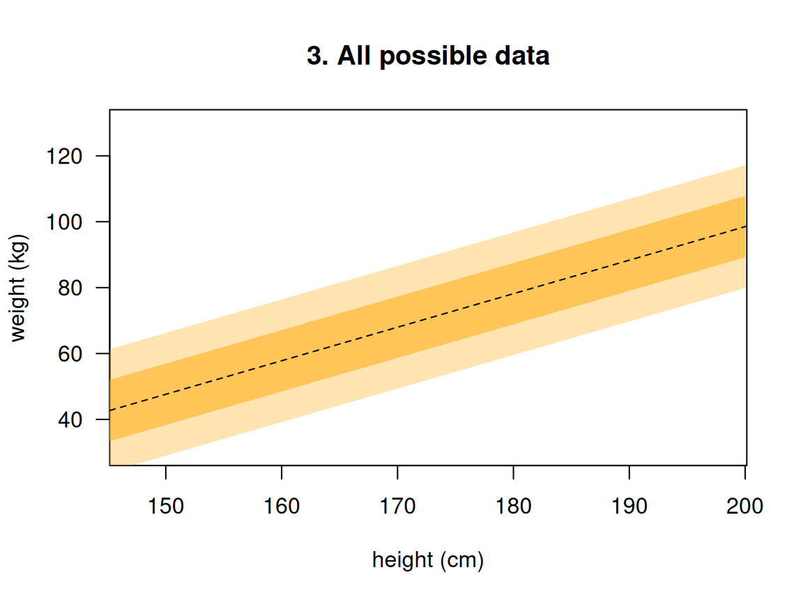

For a 180 cm person, 95% of the weights the model generates fall in this range:

``` r
b0 + b1 * 180 + c(-2, 2) * s
#> [1] 59.54368 96.77585
```

## 4. Two Predictors: Height and Age

The model from the slides, with age (years) added:

$$\mathrm{weight}_i = \beta_0 + \beta_1 \times \mathrm{height}_i + \beta_2 \times \mathrm{age}_i + \epsilon_i, \qquad \epsilon_i \sim N(0, \sigma^2)$$

A second predictor is added to the formula with `+`:

``` r
fit_two <- lm(Weight ~ Height + Age, data = body)
summary(fit_two)
#> 
#> Call:
#> lm(formula = Weight ~ Height + Age, data = body)
#> 
#> Residuals:
#>     Min      1Q  Median      3Q     Max 
#> -19.996  -5.909  -1.321   5.055  41.285 
#> 
#> Coefficients:
#>               Estimate Std. Error t value Pr(>|t|)    
#> (Intercept) -109.06383    7.38820  -14.76  < 2e-16 ***
#> Height         1.00227    0.04297   23.33  < 2e-16 ***
#> Age            0.22127    0.04207    5.26 2.14e-07 ***
#> ---
#> Signif. codes:  0 '***' 0.001 '**' 0.01 '*' 0.05 '.' 0.1 ' ' 1
#> 
#> Residual standard error: 9.072 on 504 degrees of freedom
#> Multiple R-squared:  0.5398, Adjusted R-squared:  0.538 
#> F-statistic: 295.6 on 2 and 504 DF,  p-value: < 2.2e-16
```

The coefficients table now has one row per $\beta$, and $\hat\sigma$ is still the `Residual standard error`.

With one predictor, the model was a line. With two, it is a plane: for every combination of height and age, the plane gives the mean weight. The vertical grey lines connect each person to the plane: they are the residuals. People above the plane are black, people below it are grey.

``` r
b_two <- coef(fit_two)
height_grid <- seq(min(body$Height), max(body$Height), length.out = 15)
age_grid <- seq(min(body$Age), max(body$Age), length.out = 15)
plane <- outer(height_grid, age_grid, function(height, age) b_two[1] + b_two[2] * height + b_two[3] * age)

view <- persp(height_grid, age_grid, plane, theta = -50, phi = 25, zlim = range(body$Weight), xlab = "height (cm)", ylab = "age (years)", zlab = "weight (kg)", ticktype = "detailed", col = adjustcolor("orange", 0.25), border = adjustcolor("orange", 0.8))

on_plane <- trans3d(body$Height, body$Age, fitted(fit_two), view)
data_pts <- trans3d(body$Height, body$Age, body$Weight, view)
segments(on_plane$x, on_plane$y, data_pts$x, data_pts$y, col = "grey70")
points(data_pts, pch = 19, cex = 0.5, col = ifelse(residuals(fit_two) > 0, "black", "grey50"))
```

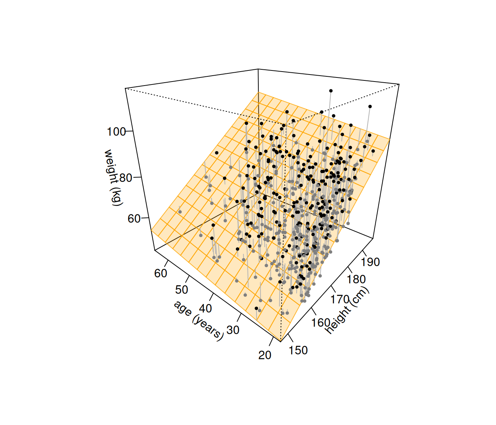

The plane is steep along the height axis and almost flat along the age axis. Each extra cm adds 1 kg, each extra year only 0.22 kg. Across the range of the data, that is about 51 kg for height and 11 kg for age.

## 5. Correlation Is a Linear Model

Standardize both variables (subtract the mean, divide by the sd). The slope of the fitted line is then the correlation coefficient $r$:

``` r
fit_z <- lm(scale(Weight) ~ scale(Height), data = body)
summary(fit_z)
#> 
#> Call:
#> lm(formula = scale(Weight) ~ scale(Height), data = body)
#> 
#> Residuals:
#>      Min       1Q   Median       3Q      Max 
#> -1.40445 -0.47969 -0.09225  0.37905  3.07983 
#> 
#> Coefficients:
#>                 Estimate Std. Error t value Pr(>|t|)    
#> (Intercept)   -8.502e-16  3.097e-02    0.00        1    
#> scale(Height)  7.173e-01  3.101e-02   23.14   <2e-16 ***
#> ---
#> Signif. codes:  0 '***' 0.001 '**' 0.01 '*' 0.05 '.' 0.1 ' ' 1
#> 
#> Residual standard error: 0.6975 on 505 degrees of freedom
#> Multiple R-squared:  0.5145, Adjusted R-squared:  0.5136 
#> F-statistic: 535.2 on 1 and 505 DF,  p-value: < 2.2e-16
```

The usual correlation test, for comparison:

``` r
cor.test(body$Weight, body$Height)
#> 
#>  Pearson's product-moment correlation
#> 
#> data:  body$Weight and body$Height
#> t = 23.135, df = 505, p-value < 2.2e-16
#> alternative hypothesis: true correlation is not equal to 0
#> 95 percent confidence interval:
#>  0.6722075 0.7570923
#> sample estimates:
#>       cor 
#> 0.7173011
```

The `Estimate` for `scale(Height)` is $r$ (R writes it as `7.173e-01`, which means 0.7173). The intercept is 0, because both variables now have mean 0: `-8.502e-16` is 0 up to rounding error. The `Multiple R-squared` is $r^2$, which is where its name comes from. Compare with section 1: the t value, R-squared, and F statistic are identical, because it is the same model on rescaled axes. And `cor.test()` reports the same $r$ (`cor`), the same t value, and the same degrees of freedom: it is this linear model, printed differently. So correlation is not a separate method: it is the linear model of section 1, with both variables standardized.

Standardizing is not even needed to find $r$. Rescaling the axes changes the slope, but not how well the line fits, so the R² of the original fit from section 1 is also $r^2$. Its square root is $r$:

``` r
summary(fit)$r.squared               # R-squared of Weight ~ Height, no standardizing
#> [1] 0.5145208
sqrt(summary(fit)$r.squared)         # r
#> [1] 0.7173011
cor(body$Weight, body$Height)        # the same r
#> [1] 0.7173011
```

The square root is always positive, so it loses the sign of $r$. The sign is the sign of the slope: here positive, because taller people are heavier.

## Reference

Heinz, G., Peterson, L. J., Johnson, R. W., & Kerk, C. J. (2003). Exploring relationships in body dimensions. *Journal of Statistics Education*, 11(2).
