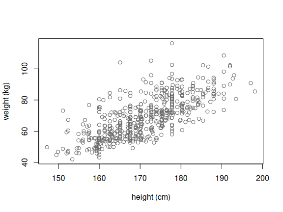
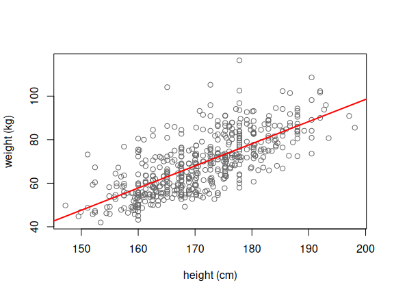
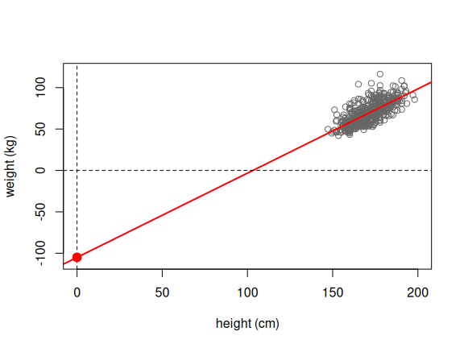
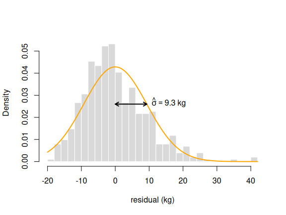
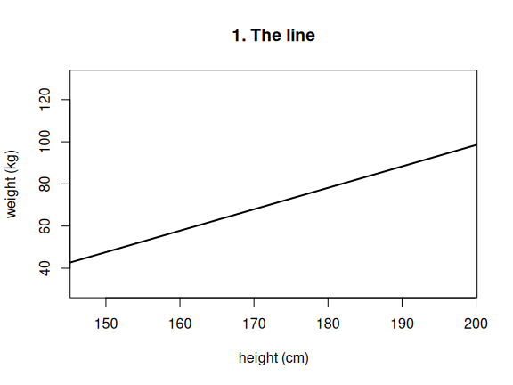
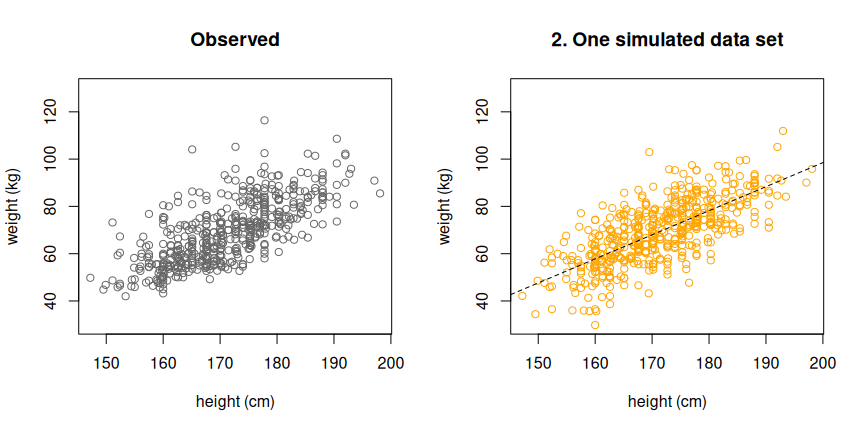
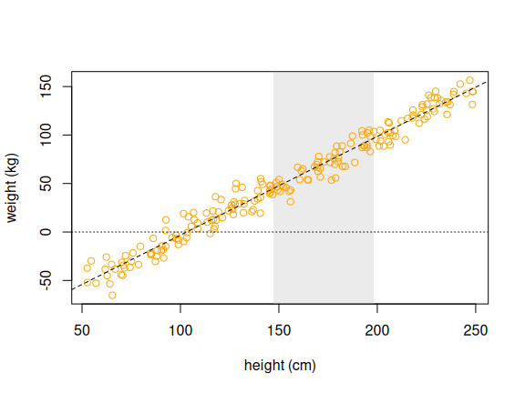
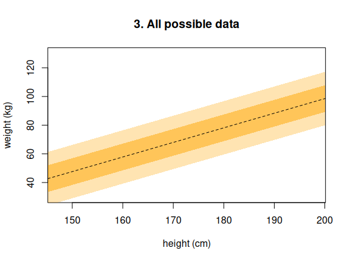

Fitting Linear Models
================
28 October, 2026 15:29

## The data

Body measurements of 507 physically active adults (Heinz et al., 2003).
We use three columns: weight (kg), height (cm), and age (years).

``` r
body <- read.csv("data/body.csv")

head(body[, c("Weight", "Height", "Age")])
```

    ##   Weight Height Age
    ## 1   65.6  174.0  21
    ## 2   71.8  175.3  23
    ## 3   80.7  193.5  28
    ## 4   72.6  186.5  23
    ## 5   78.8  187.2  22
    ## 6   74.8  181.5  21

``` r
nrow(body)
```

    ## [1] 507

## 1. One continuous predictor: weight and height

The model:

$$\mathrm{weight}_i = \beta_0 + \beta_1 \times \mathrm{height}_i + \epsilon_i, \qquad \epsilon_i \sim N(0, \sigma^2)$$

``` r
plot(body$Height, body$Weight, xlab = "height (cm)", ylab = "weight (kg)", col = "grey40")
```

<!-- -->

`lm()` finds the least-squares values of $\beta_0$ and $\beta_1$. The
formula `Weight ~ Height` reads “weight, predicted by height”. The
intercept is included automatically.

``` r
fit <- lm(Weight ~ Height, data = body)
summary(fit)
```

    ## 
    ## Call:
    ## lm(formula = Weight ~ Height, data = body)
    ## 
    ## Residuals:
    ##     Min      1Q  Median      3Q     Max 
    ## -18.743  -6.402  -1.231   5.059  41.103 
    ## 
    ## Coefficients:
    ##               Estimate Std. Error t value Pr(>|t|)    
    ## (Intercept) -105.01125    7.53941  -13.93   <2e-16 ***
    ## Height         1.01762    0.04399   23.14   <2e-16 ***
    ## ---
    ## Signif. codes:  0 '***' 0.001 '**' 0.01 '*' 0.05 '.' 0.1 ' ' 1
    ## 
    ## Residual standard error: 9.308 on 505 degrees of freedom
    ## Multiple R-squared:  0.5145, Adjusted R-squared:  0.5136 
    ## F-statistic: 535.2 on 1 and 505 DF,  p-value: < 2.2e-16

The three parameters in this output are:

- **$\hat\beta_0$ and $\hat\beta_1$:** the `Estimate` column of the
  coefficients table, in the rows `(Intercept)` and `Height`.
- **$\hat\sigma$:** the line `Residual standard error`. The “degrees of
  freedom” next to it are $n - 2$: the 507 people minus the two fitted
  $\beta$’s.

The rest (standard errors, t values, p values, R², the F statistic) is
for later: hypothesis testing and model comparison. The parameters can
also be pulled out of the fit directly:

``` r
coef(fit)     # beta_0 and beta_1
```

    ## (Intercept)      Height 
    ## -105.011254    1.017617

``` r
sigma(fit)    # sigma
```

    ## [1] 9.30804

``` r
plot(body$Height, body$Weight, xlab = "height (cm)", ylab = "weight (kg)", col = "grey40")
abline(fit, col = "red", lwd = 2)
```

<!-- -->

What the three numbers mean:

- **$\hat\beta_1$ (slope):** each extra cm of height adds about 1.02 kg
  to the predicted weight.
- **$\hat\beta_0$ (intercept):** the predicted weight at height 0. Here
  that is -105 kg, which is nonsense: nobody is 0 cm tall. The intercept
  is where the line crosses x = 0, even when that is far outside the
  data.
- **$\hat\sigma$:** the typical distance of a person from the line,
  about 9.3 kg.

The intercept, made visible by extending the axes to height 0:

``` r
plot(body$Height, body$Weight, xlab = "height (cm)", ylab = "weight (kg)", col = "grey40", xlim = c(0, 200), ylim = c(-110, 120))
abline(fit, col = "red", lwd = 2)
abline(h = 0, v = 0, lty = 2)
points(0, coef(fit)[1], pch = 19, col = "red", cex = 1.5)
```

<!-- -->

If the errors are normal, about 95% of people should lie within
$2\hat\sigma$ of the line:

``` r
mean(abs(residuals(fit)) < 2 * sigma(fit))
```

    ## [1] 0.9566075

The model assumes the errors are normal with mean 0 and sd $\sigma$. The
residuals are our estimates of the errors, so we can compare their
distribution with that assumption:

``` r
hist(residuals(fit), breaks = 30, freq = FALSE, main = "", xlab = "residual (kg)", col = "grey85", border = "white")
curve(dnorm(x, mean = 0, sd = sigma(fit)), add = TRUE, col = "orange", lwd = 2)

# sigma-hat: from 0 to one sd, drawn where the curve bends (at one sd)
s <- sigma(fit)
y_s <- dnorm(s, mean = 0, sd = s)
arrows(0, y_s, s, y_s, code = 3, length = 0.08, lwd = 2)
text(s, y_s, bquote(hat(sigma) == .(round(s, 1)) ~ kg), pos = 4)
```

<!-- -->

The histogram is the residuals; the orange curve is the normal
distribution the model assumes, with sd $\hat\sigma$. They roughly
agree, but the residuals are skewed: a long tail of people much heavier
than the line predicts, and too few much lighter.

## 2. The fitted model as a generative model

The fitted model gives values for all three parameters so that it can
generate data. As on the slides, it can do so in three ways.

``` r
b0 <- unname(coef(fit)[1])
b1 <- unname(coef(fit)[2])
s  <- sigma(fit)
n  <- nrow(body)
```

### Mode 1: the line

$$\mu_i = \hat\beta_0 + \hat\beta_1 \times \mathrm{height}_i = -105 + 1.02 \times \mathrm{height}_i$$

The line gives the *mean* weight of people of a given height. For a 180
cm person:

``` r
b0 + b1 * 180
```

    ## [1] 78.15977

``` r
plot(body$Height, body$Weight, type = "n", xlab = "height (cm)", ylab = "weight (kg)", ylim = c(30, 130), main = "1. The line")
abline(b0, b1, lwd = 2)
```

<!-- -->

### Mode 2: one simulated data set

$$\mathrm{weight}_i = -105 + 1.02 \times \mathrm{height}_i + \epsilon_i, \qquad \epsilon_i \sim N(0, 9.3^2)$$

Same heights, new weights: the line plus normal noise with sd
$\hat\sigma$.

``` r
set.seed(1)
sim_weight <- b0 + b1 * body$Height + rnorm(n, 0, s)

par(mfrow = c(1, 2))
plot(body$Height, body$Weight, main = "Observed", xlab = "height (cm)", ylab = "weight (kg)", col = "grey40", ylim = c(30, 130))
plot(body$Height, sim_weight, main = "2. One simulated data set", xlab = "height (cm)", ylab = "weight (kg)", col = "orange", ylim = c(30, 130))
abline(b0, b1, lty = 2)
```

<!-- -->

``` r
par(mfrow = c(1, 1))
```

Does the simulated data look like the observed data? Where does it
differ?

Nothing in the model stops us from feeding it heights we never measured.
Here are 200 people with heights from 50 to 250 cm:

``` r
set.seed(1)
new_height <- runif(200, 50, 250)
new_weight <- b0 + b1 * new_height + rnorm(200, 0, s)

plot(new_height, new_weight, type = "n", xlab = "height (cm)", ylab = "weight (kg)")
rect(min(body$Height), -1000, max(body$Height), 1000, col = adjustcolor("grey", 0.3), border = NA)
points(new_height, new_weight, col = "orange")
abline(b0, b1, lty = 2)
abline(h = 0, lty = 3)
```

<!-- -->

The grey strip is the range of heights in the data. Outside it, the
model keeps generating weights, and below about 103 cm they become
negative. The model is only as good as the data it was fitted to: it
knows nothing about babies or giants.

### Mode 3: all possible data

$$\mathrm{weight}_i \sim N(-105 + 1.02 \times \mathrm{height}_i,\ 9.3^2)$$

At every height, a normal distribution of weights around the line. The
bands hold the middle 68% ($\pm 1\hat\sigma$) and 95%
($\pm 2\hat\sigma$) of the weights the model generates:

``` r
h <- seq(140, 200, length.out = 100)
mu <- b0 + b1 * h
plot(body$Height, body$Weight, type = "n", xlab = "height (cm)", ylab = "weight (kg)", ylim = c(30, 130), main = "3. All possible data")
polygon(c(h, rev(h)), c(mu - 2 * s, rev(mu + 2 * s)), col = adjustcolor("orange", 0.3), border = NA)
polygon(c(h, rev(h)), c(mu - s, rev(mu + s)), col = adjustcolor("orange", 0.5), border = NA)
abline(b0, b1, lty = 2)
```

<!-- -->

For a 180 cm person, 95% of the weights the model generates fall in this
range:

``` r
b0 + b1 * 180 + c(-2, 2) * s
```

    ## [1] 59.54368 96.77585

## 3. Two predictors: height and age

The model from the slides, with age (years) added:

$$\mathrm{weight}_i = \beta_0 + \beta_1 \times \mathrm{height}_i + \beta_2 \times \mathrm{age}_i + \epsilon_i, \qquad \epsilon_i \sim N(0, \sigma^2)$$

A second predictor is added to the formula with `+`:

``` r
fit_two <- lm(Weight ~ Height + Age, data = body)
summary(fit_two)
```

    ## 
    ## Call:
    ## lm(formula = Weight ~ Height + Age, data = body)
    ## 
    ## Residuals:
    ##     Min      1Q  Median      3Q     Max 
    ## -19.996  -5.909  -1.321   5.055  41.285 
    ## 
    ## Coefficients:
    ##               Estimate Std. Error t value Pr(>|t|)    
    ## (Intercept) -109.06383    7.38820  -14.76  < 2e-16 ***
    ## Height         1.00227    0.04297   23.33  < 2e-16 ***
    ## Age            0.22127    0.04207    5.26 2.14e-07 ***
    ## ---
    ## Signif. codes:  0 '***' 0.001 '**' 0.01 '*' 0.05 '.' 0.1 ' ' 1
    ## 
    ## Residual standard error: 9.072 on 504 degrees of freedom
    ## Multiple R-squared:  0.5398, Adjusted R-squared:  0.538 
    ## F-statistic: 295.6 on 2 and 504 DF,  p-value: < 2.2e-16

The coefficients table now has one row per $\beta$, and $\hat\sigma$ is
still the `Residual standard error`.

## 4. Correlation is regression on z-scores

Standardize both variables (subtract the mean, divide by the sd). The
slope of the fitted line is then the correlation coefficient $r$:

``` r
fit_z <- lm(scale(Weight) ~ scale(Height), data = body)
summary(fit_z)
```

    ## 
    ## Call:
    ## lm(formula = scale(Weight) ~ scale(Height), data = body)
    ## 
    ## Residuals:
    ##      Min       1Q   Median       3Q      Max 
    ## -1.40445 -0.47969 -0.09225  0.37905  3.07983 
    ## 
    ## Coefficients:
    ##                 Estimate Std. Error t value Pr(>|t|)    
    ## (Intercept)   -8.502e-16  3.097e-02    0.00        1    
    ## scale(Height)  7.173e-01  3.101e-02   23.14   <2e-16 ***
    ## ---
    ## Signif. codes:  0 '***' 0.001 '**' 0.01 '*' 0.05 '.' 0.1 ' ' 1
    ## 
    ## Residual standard error: 0.6975 on 505 degrees of freedom
    ## Multiple R-squared:  0.5145, Adjusted R-squared:  0.5136 
    ## F-statistic: 535.2 on 1 and 505 DF,  p-value: < 2.2e-16

The usual correlation test, for comparison:

``` r
cor.test(body$Weight, body$Height)
```

    ## 
    ##  Pearson's product-moment correlation
    ## 
    ## data:  body$Weight and body$Height
    ## t = 23.135, df = 505, p-value < 2.2e-16
    ## alternative hypothesis: true correlation is not equal to 0
    ## 95 percent confidence interval:
    ##  0.6722075 0.7570923
    ## sample estimates:
    ##       cor 
    ## 0.7173011

The `Estimate` for `scale(Height)` is $r$ (R writes it as `7.173e-01`,
which means 0.7173). The intercept is 0, because both variables now have
mean 0: `-8.502e-16` is 0 up to rounding error. The `Multiple R-squared`
is $r^2$, which is where its name comes from. Compare with section 1:
the t value, R-squared, and F statistic are identical, because it is the
same model on rescaled axes. And `cor.test()` reports the same $r$
(`cor`), the same t value, and the same degrees of freedom: it is this
linear model, printed differently.

So correlation is not a separate method: it is the linear model of
section 1, with both variables standardized.

## Reference

Heinz, G., Peterson, L. J., Johnson, R. W., & Kerk, C. J. (2003).
Exploring relationships in body dimensions. *Journal of Statistics
Education*, 11(2).
