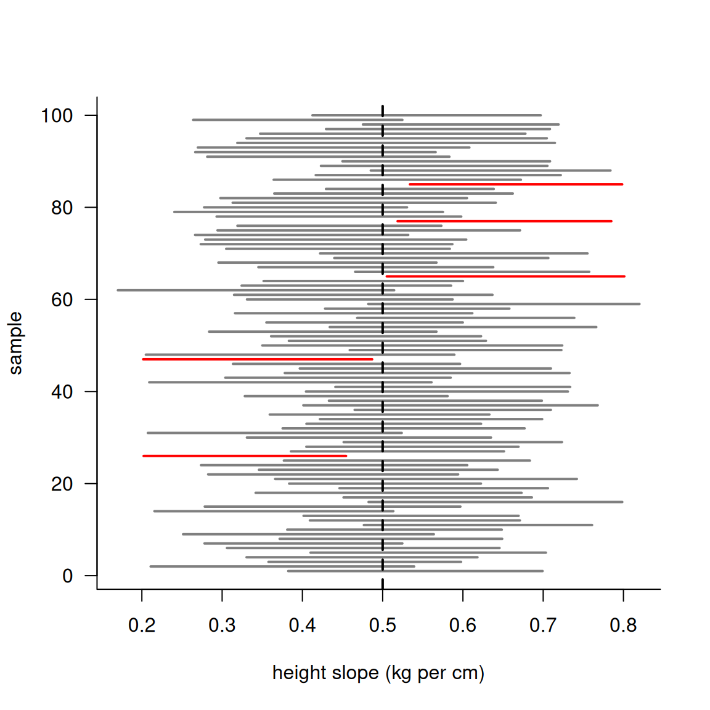

Confidence Intervals
================

- [The R You Need](#the-r-you-need)
- [The Data](#the-data)
- [1. The Standard Error in the Output](#1-the-standard-error-in-the-output)
- [2. From Standard Error to Confidence Interval](#2-from-standard-error-to-confidence-interval)
- [3. What the 95% Means](#3-what-the-95-means)
- [4. Reading the Intervals](#4-reading-the-intervals)
- [5. Extra: The Standard Error by Hand](#5-extra-the-standard-error-by-hand)
- [Reference](#reference)

## The R You Need

To get confidence intervals for the coefficients of a linear model, you need one command on top of what you used for fitting:

- **`confint()`:** takes a fitted model and returns the 95% confidence interval for every coefficient. Add `level = 0.9` (or any other value) for a different confidence level.

A minimal example, with the data used below:

``` r
body <- read.csv("data/body.csv")
fit <- lm(Weight ~ Height + Age, data = body)
confint(fit)
```

The rest of this file shows where these numbers come from, step by step, and what the 95% means. Open `08_ConfidenceIntervals.Rproj` first, so that R finds the data file.

## The Data

The body measurements from the linear-model file: 507 physically active adults (Heinz et al., 2003). We use weight (kg), height (cm), and age (years).

``` r
body <- read.csv("data/body.csv")

head(body[, c("Weight", "Height", "Age")])
#>   Weight Height Age
#> 1   65.6  174.0  21
#> 2   71.8  175.3  23
#> 3   80.7  193.5  28
#> 4   72.6  186.5  23
#> 5   78.8  187.2  22
#> 6   74.8  181.5  21
nrow(body)
#> [1] 507
```

## 1. The Standard Error in the Output

The model, with two predictors:

$$\mathrm{weight}_i = \beta_0 + \beta_1 \times \mathrm{height}_i + \beta_2 \times \mathrm{age}_i + \epsilon_i, \qquad \epsilon_i \sim N(0, \sigma^2)$$

``` r
fit <- lm(Weight ~ Height + Age, data = body)
summary(fit)
#> 
#> Call:
#> lm(formula = Weight ~ Height + Age, data = body)
#> 
#> Residuals:
#>     Min      1Q  Median      3Q     Max 
#> -19.996  -5.909  -1.321   5.055  41.285 
#> 
#> Coefficients:
#>               Estimate Std. Error t value Pr(>|t|)    
#> (Intercept) -109.06383    7.38820  -14.76  < 2e-16 ***
#> Height         1.00227    0.04297   23.33  < 2e-16 ***
#> Age            0.22127    0.04207    5.26 2.14e-07 ***
#> ---
#> Signif. codes:  0 '***' 0.001 '**' 0.01 '*' 0.05 '.' 0.1 ' ' 1
#> 
#> Residual standard error: 9.072 on 504 degrees of freedom
#> Multiple R-squared:  0.5398, Adjusted R-squared:  0.538 
#> F-statistic: 295.6 on 2 and 504 DF,  p-value: < 2.2e-16
```

> [!NOTE]
> Two parts of this output are needed for a confidence interval:
>
> - **$\hat\sigma_{\hat\beta_j}$, the standard error:** the column `Std. Error` of the coefficients table. It is our estimate of how much each $\hat\beta_j$ would vary from sample to sample. For height that is 0.043. As on the slides, R calculates it from $\hat\sigma$, the `Residual standard error` (9.07 kg): $\hat\sigma_{\hat\beta_j} = \hat\sigma \times \sqrt{[(X^\top X)^{-1}]_{jj}}$. Section 5 repeats that calculation by hand.
> - **The degrees of freedom:** on the same line as the `Residual standard error` (504). They tell us which $t$-distribution to use.

The standard errors can be pulled out of the fit directly:

``` r
se <- summary(fit)$coefficients[, "Std. Error"]
se
#> (Intercept)      Height         Age 
#>  7.38819915  0.04296869  0.04206863
```

## 2. From Standard Error to Confidence Interval

On the slides, the distance between an estimate and the true value, measured in standard errors, follows a $t$-distribution:

$$\frac{\hat\beta_j - \beta_j}{\hat\sigma_{\hat\beta_j}} \sim t_{n-p}$$

with $n$ the number of data points and $p$ the number of coefficients, including the intercept. Here $n = 507$ and $p = 3$:

``` r
n <- nrow(body)
p <- length(coef(fit))
n - p
#> [1] 504
df.residual(fit)    # the same, from the fit
#> [1] 504
```

In 95% of samples the distance lies between the 2.5% and 97.5% points of that $t$-distribution. `qt()` gives these points:

``` r
t_value <- qt(0.975, df = n - p)
t_value
#> [1] 1.964682
```

With so many degrees of freedom, this is close to the 1.96 of the normal distribution. Turning the distance around gives the confidence interval:

$$\hat\beta_j \pm t_{0.975,\, n-p} \times \hat\sigma_{\hat\beta_j}$$

``` r
estimate <- coef(fit)
lower <- estimate - t_value * se
upper <- estimate + t_value * se
cbind(lower, upper)
#>                    lower       upper
#> (Intercept) -123.5792876 -94.5483638
#> Height         0.9178550   1.0866946
#> Age            0.1386185   0.3039214
```

This is exactly what `confint()` returns:

``` r
confint(fit)
#>                    2.5 %      97.5 %
#> (Intercept) -123.5792876 -94.5483638
#> Height         0.9178550   1.0866946
#> Age            0.1386185   0.3039214
```

A different confidence level only changes the $t$-value. A 99% interval is wider, a 90% interval narrower:

``` r
confint(fit, level = 0.99)
#>                    0.5 %      99.5 %
#> (Intercept) -128.1668956 -89.9607559
#> Height         0.8911742   1.1133755
#> Age            0.1124965   0.3300434
confint(fit, level = 0.90)
#>                      5 %        95 %
#> (Intercept) -121.2387104 -96.8889411
#> Height         0.9314675   1.0730822
#> Age            0.1519458   0.2905941
qt(c(0.95, 0.975, 0.995), df = n - p)    # the t-values for 90%, 95% and 99%
#> [1] 1.647883 1.964682 2.585619
```

## 3. What the 95% Means

With real data we never know the true $\beta$, so we cannot check whether an interval contains it. With a simulated population we can. This is the penguin colony from the slides:

$$\mathrm{weight}_i = -28 + 0.5 \times \mathrm{height}_i + 0.15 \times \mathrm{age}_i + \epsilon_i, \qquad \epsilon_i \sim N(0, 3^2)$$

``` r
set.seed(4)
N <- 100000
height <- rnorm(N, mean = 115, sd = 6)
age <- runif(N, min = 2, max = 20)
weight <- -28 + 0.5 * height + 0.15 * age + rnorm(N, mean = 0, sd = 3)
true_slope <- 0.5
```

We take 100 samples of 50 penguins. For each sample we fit the model and store the 95% confidence interval for the height slope:

``` r
repeats <- 100
lower <- rep(NA, repeats)
upper <- rep(NA, repeats)

for (i in 1:repeats)
{
  chosen <- sample(1:N, size = 50)
  sample_fit <- lm(weight[chosen] ~ height[chosen] + age[chosen])
  lower[i] <- confint(sample_fit)[2, 1]
  upper[i] <- confint(sample_fit)[2, 2]
}

hit <- lower < true_slope & true_slope < upper    # does the interval contain the truth?
sum(hit)
#> [1] 95
```

Each horizontal line is one interval. Grey: it contains the true slope (the dashed line). Red: it misses.

``` r
plot(NA, xlim = range(c(lower, upper)), ylim = c(1, repeats), xlab = "height slope (kg per cm)", ylab = "sample")
segments(lower, 1:repeats, upper, 1:repeats, col = ifelse(hit, "grey50", "red"), lwd = 2)
abline(v = true_slope, lty = 2, lwd = 2)
```



95 of the 100 intervals contain the true slope. That is what the 95% is about: the procedure, repeated on new samples, catches the true value 95% of the time. For any one interval, the true value is either inside or not; we just do not know which.

> [!WARNING]
> The 95% only holds if the assumptions of the model hold. The most important one: nothing is left out that is linked to the predictors in the model. `MissingPredictor.R` shows what happens when it is: the intervals gather around the wrong value, and almost none contain the truth.

## 4. Reading the Intervals

Back to the body data:

``` r
confint(fit)
#>                    2.5 %      97.5 %
#> (Intercept) -123.5792876 -94.5483638
#> Height         0.9178550   1.0866946
#> Age            0.1386185   0.3039214
```

- **Height:** each extra cm of height goes with between 0.92 and 1.09 kg extra weight, at a given age.
- **Age:** each extra year goes with between 0.14 and 0.3 kg extra weight, at a given height.

Compare this with the $p$-values in `summary(fit)`. They say that both effects are different from zero, and nothing more. The intervals say how large the effects plausibly are, and how precisely we know that. An interval that excludes zero also tells you that $p < 0.05$, so you lose nothing by reporting the interval instead.

## 5. Extra: The Standard Error by Hand

For those who want to see where the `Std. Error` column comes from. On the slides, the standard error is $\hat\sigma$ times a number that depends only on the predictors:

$$\hat\sigma_{\hat\beta_j} = \hat\sigma \times \sqrt{\big[(X^\top X)^{-1}\big]_{jj}}$$

$X$ is the matrix of predictors: one row per person, a column of 1s for the intercept, then one column per predictor. R builds it for us:

``` r
X <- model.matrix(fit)
head(X)
#>   (Intercept) Height Age
#> 1           1  174.0  21
#> 2           1  175.3  23
#> 3           1  193.5  28
#> 4           1  186.5  23
#> 5           1  187.2  22
#> 6           1  181.5  21
```

The second part of the equation: invert $X^\top X$ and take the square root of its diagonal. You do not need to follow the matrix algebra; the point is that R’s standard errors come out of exactly this equation.

``` r
XtX_inverse <- solve(t(X) %*% X)          # (X'X)^-1
second_term <- sqrt(diag(XtX_inverse))    # one number per coefficient
second_term
#> (Intercept)      Height         Age 
#> 0.814429723 0.004736604 0.004637387

sigma(fit) * second_term                  # sigma-hat times the second term
#> (Intercept)      Height         Age 
#>  7.38819915  0.04296869  0.04206863
se                                        # R's Std. Error: the same
#> (Intercept)      Height         Age 
#>  7.38819915  0.04296869  0.04206863
```

## Reference

Heinz, G., Peterson, L. J., Johnson, R. W., & Kerk, C. J. (2003). Exploring relationships in body dimensions. *Journal of Statistics Education*, 11(2).
