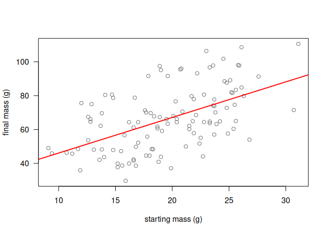
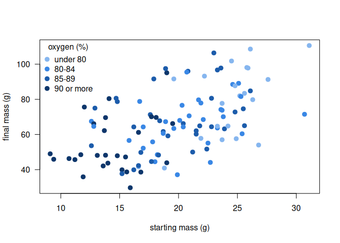
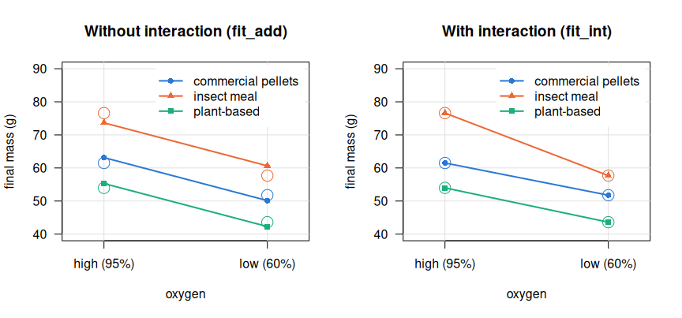

Exercise set: Linear models
================
BIOL8001 Graduate Statistics
2026-11-23


This set covers sections 7 to 10. Questions 1 to 5 use one simulated
data set; question 6 uses simulated data from a follow-up experiment.
Several questions ask you to fit a model in R. Please try to run at
least some of these models yourself. Either way, the output is printed
below the code, so you can check your results and carry on with the
questions.

## The Data

A hatchery raises juvenile trout to restock a river where the wild
population has declined. Fish that are larger when they are released
survive better in the river, so the hatchery wants them to grow well. It
compared three diets and two water temperatures. Each fish was raised
alone in its own tank for 12 weeks, on one of the diets, in cold (10 °C)
or warm (14 °C) water. The file `trout.csv`, in the `data` folder of
section 10, has one row for each fish. The numbers are in a realistic
range for juvenile trout.

| Column | Meaning |
|----|----|
| `fish` | Fish number |
| `diet` | Diet: 1 = commercial pellets, 2 = insect meal, 3 = plant-based |
| `water` | Water temperature: `cold` (10 °C) or `warm` (14 °C) |
| `start_mass` | Mass at the start of the trial (g) |
| `oxygen` | Dissolved oxygen in the tank on day 1 of the trial (% saturation) |
| `final_mass` | Mass at the end of the trial (g) |

``` r
trout <- read.csv("data/trout.csv")
head(trout)
#>   fish diet water start_mass oxygen final_mass
#> 1    1    2  cold       15.6     90       38.7
#> 2    2    3  warm       25.6     73       83.4
#> 3    3    1  cold       24.9     77       57.6
#> 4    4    1  cold       15.2     92       39.9
#> 5    5    2  cold       16.6     79       41.6
#> 6    6    2  cold       11.2    100       45.7
```

## Question 1: Final Mass and Starting Mass

Fit a model with starting mass as the only predictor:

``` r
fit1 <- lm(final_mass ~ start_mass, data = trout)
summary(fit1)
#> 
#> Call:
#> lm(formula = final_mass ~ start_mass, data = trout)
#> 
#> Residuals:
#>     Min      1Q  Median      3Q     Max 
#> -29.820 -11.471  -1.228   9.161  32.962 
#> 
#> Coefficients:
#>             Estimate Std. Error t value Pr(>|t|)    
#> (Intercept)  25.0804     6.3099   3.975 0.000125 ***
#> start_mass    2.1025     0.3132   6.713 8.23e-10 ***
#> ---
#> Signif. codes:  0 '***' 0.001 '**' 0.01 '*' 0.05 '.' 0.1 ' ' 1
#> 
#> Residual standard error: 15.79 on 112 degrees of freedom
#> Multiple R-squared:  0.2869, Adjusted R-squared:  0.2805 
#> F-statistic: 45.06 on 1 and 112 DF,  p-value: 8.227e-10
```

The graph below shows the data, with the fitted model as a line:

<!-- -->

**(1a)** Write down the model that R fitted, as an equation with the
estimated values filled in.

**(1b)** In words, and with units, what does the coefficient of
`start_mass` say about trout? Be explicit about whether your
statement(s) are about the sample or about the population.

**(1c)** The intercept is 25.1 g. Which trout does the model make this
prediction for, and how does that trout compare with the fish in the
data?

**(1d)** A colleague points at R² = 0.29 and concludes that starting
mass hardly matters for how big a trout gets. How much does starting
mass matter? Use the numbers in the output.

**(1e)** Use the model you wrote down in (1a). Between which final
masses does it predict that 95% of trout starting at 20 g will end up?
Show how you got the numbers.

## Question 2: A Second Predictor

Add oxygen to the model from question 1:

``` r
fit2 <- lm(final_mass ~ start_mass + oxygen, data = trout)
summary(fit2)
#> 
#> Call:
#> lm(formula = final_mass ~ start_mass + oxygen, data = trout)
#> 
#> Residuals:
#>     Min      1Q  Median      3Q     Max 
#> -30.303 -11.446  -1.362   9.054  34.261 
#> 
#> Coefficients:
#>             Estimate Std. Error t value Pr(>|t|)    
#> (Intercept)  45.6934    32.6404   1.400    0.164    
#> start_mass    1.9148     0.4285   4.468 1.91e-05 ***
#> oxygen       -0.1999     0.3106  -0.644    0.521    
#> ---
#> Signif. codes:  0 '***' 0.001 '**' 0.01 '*' 0.05 '.' 0.1 ' ' 1
#> 
#> Residual standard error: 15.83 on 111 degrees of freedom
#> Multiple R-squared:  0.2895, Adjusted R-squared:  0.2767 
#> F-statistic: 22.62 on 2 and 111 DF,  p-value: 5.759e-09
```

For comparison, a model with oxygen as the only predictor:

``` r
fit_oxygen <- lm(final_mass ~ oxygen, data = trout)
summary(fit_oxygen)
#> 
#> Call:
#> lm(formula = final_mass ~ oxygen, data = trout)
#> 
#> Residuals:
#>     Min      1Q  Median      3Q     Max 
#> -35.323 -12.582  -0.409  10.930  43.908 
#> 
#> Coefficients:
#>             Estimate Std. Error t value Pr(>|t|)    
#> (Intercept) 163.1846    20.9105   7.804 3.43e-12 ***
#> oxygen       -1.1442     0.2461  -4.649 9.17e-06 ***
#> ---
#> Signif. codes:  0 '***' 0.001 '**' 0.01 '*' 0.05 '.' 0.1 ' ' 1
#> 
#> Residual standard error: 17.12 on 112 degrees of freedom
#> Multiple R-squared:  0.1618, Adjusted R-squared:  0.1543 
#> F-statistic: 21.61 on 1 and 112 DF,  p-value: 9.173e-06
```

The data from question 1, with each fish coloured by the oxygen in its
tank:

<!-- -->

The correlations between the three variables:

``` r
round(cor(trout[, c("start_mass", "oxygen", "final_mass")]), 2)
#>            start_mass oxygen final_mass
#> start_mass       1.00  -0.68       0.54
#> oxygen          -0.68   1.00      -0.40
#> final_mass       0.54  -0.40       1.00
```

**(2a)** The coefficient of `start_mass` went from 2.10 in `fit1` to
1.91 in `fit2`. The coefficient of `oxygen` went from −1.14 in
`fit_oxygen` to −0.20 in `fit2`. Why did each coefficient change as it
did? Use the plot.

**(2b)** A colleague fitted only `fit_oxygen` and concluded that more
oxygen makes trout grow less. What can you conclude about oxygen? Be
explicit about whether your statement(s) are about the sample or about
the population.

## Question 3: Confidence Intervals

The 95% confidence intervals for the coefficients of the three models:

``` r
confint(fit1)
#>                 2.5 %    97.5 %
#> (Intercept) 12.578163 37.582735
#> start_mass   1.481894  2.723095
confint(fit2)
#>                   2.5 %      97.5 %
#> (Intercept) -18.9857932 110.3725343
#> start_mass    1.0655898   2.7639778
#> oxygen       -0.8154013   0.4155275
confint(fit_oxygen)
#>                  2.5 %      97.5 %
#> (Intercept) 121.753036 204.6161234
#> oxygen       -1.631887  -0.6565761
```

**(3a)** Calculate the 95% confidence interval for the coefficient of
`start_mass` in `fit1` yourself, from the estimate and the standard
error in the output of question 1. Show your steps, and check your
answer against `confint(fit1)`.

**(3b)** The interval for `start_mass` in `fit1` runs from 1.48 to 2.72.
Which of these statements are correct? Explain each answer.

1.  There is a 95% probability that the true slope lies between 1.48 and
    2.72.
2.  If the trial were repeated many times with new trout, and an
    interval calculated in the same way each time, about 95% of those
    intervals would contain the true slope.
3.  In 95% of the trout in this trial, each extra gram of starting mass
    added between 1.48 and 2.72 g of final mass.
4.  If the trial were repeated with new trout, the new estimate of the
    slope would lie between 1.48 and 2.72 with a probability of 95%.

**(3c)** Suppose the hatchery had raised four times as many trout.
Roughly how wide would the interval for `start_mass` in `fit1` be?
Explain.

**(3d)** The data are simulated, so we know the population values of the
$\beta$s: the values in the model the data were simulated from. In that
model, $\beta_\mathrm{start} = 2$: each extra gram of starting mass adds
2 g of final mass. And $\beta_\mathrm{oxygen} = 0$: oxygen does not
affect final mass. Which of the intervals for `start_mass` and `oxygen`
above contain these values? Explain what you find.

## Question 4: Diet

Diet is stored in the data as 1, 2, and 3. The mean final mass of the
fish on each diet:

| Code | Diet               | Mean final mass (g) |
|:----:|:-------------------|--------------------:|
|  1   | commercial pellets |                63.4 |
|  2   | insect meal        |                76.5 |
|  3   | plant-based        |                59.6 |

Two models with diet as the only predictor. In the first, diet is
entered as stored. In the second, it is entered as a factor, with the
codes replaced by the names of the feeds:

``` r
fit_codes <- lm(final_mass ~ diet, data = trout)
summary(fit_codes)
#> 
#> Call:
#> lm(formula = final_mass ~ diet, data = trout)
#> 
#> Residuals:
#>     Min      1Q  Median      3Q     Max 
#> -34.657 -15.930  -0.756  12.220  44.344 
#> 
#> Coefficients:
#>             Estimate Std. Error t value Pr(>|t|)    
#> (Intercept)   70.054      4.566   15.34   <2e-16 ***
#> diet          -1.899      2.110   -0.90     0.37    
#> ---
#> Signif. codes:  0 '***' 0.001 '**' 0.01 '*' 0.05 '.' 0.1 ' ' 1
#> 
#> Residual standard error: 18.63 on 112 degrees of freedom
#> Multiple R-squared:  0.007179,   Adjusted R-squared:  -0.001685 
#> F-statistic: 0.8099 on 1 and 112 DF,  p-value: 0.3701

trout$feed <- factor(trout$diet, levels = 1:3, labels = c("pellet", "insect", "plant"))
fit_diet <- lm(final_mass ~ feed, data = trout)
summary(fit_diet)
#> 
#> Call:
#> lm(formula = final_mass ~ feed, data = trout)
#> 
#> Residuals:
#>     Min      1Q  Median      3Q     Max 
#> -37.847 -12.368   0.323  14.938  34.395 
#> 
#> Coefficients:
#>             Estimate Std. Error t value Pr(>|t|)    
#> (Intercept)   63.405      2.774  22.856  < 2e-16 ***
#> feedinsect    13.142      4.004   3.282  0.00138 ** 
#> feedplant     -3.797      3.923  -0.968  0.33518    
#> ---
#> Signif. codes:  0 '***' 0.001 '**' 0.01 '*' 0.05 '.' 0.1 ' ' 1
#> 
#> Residual standard error: 17.32 on 111 degrees of freedom
#> Multiple R-squared:  0.1494, Adjusted R-squared:  0.1341 
#> F-statistic: 9.751 on 2 and 111 DF,  p-value: 0.0001255
```

**(4a)** Write down both models as equations. For each diet, what mean
final mass does each model give?

**(4b)** How much does diet matter for final mass, according to each
model? Explain the difference, using the diet means above.

**(4c)** The last line of `summary(fit_diet)` reports an $F$-test. Which
hypothesis does it test, and what do you conclude? Be explicit about
whether your statement(s) are about the sample or about the population.

**(4d)** Suppose the hatchery had coded the diets differently: 1 =
commercial pellets, 2 = plant-based, 3 = insect meal. What would change
in `fit_codes`, and what in `fit_diet`? You can answer without fitting
anything. To check your answer in R,
`trout$diet2 <- c(1, 3, 2)[trout$diet]` gives the new codes.

## Question 5: The Plant-Based Feed

The hatchery wants to know how the plant-based feed (diet 3) compares
with the commercial pellets (diet 1). The mean starting and final mass
of the fish on each diet:

| Code | Diet               | Mean starting mass (g) | Mean final mass (g) |
|:----:|:-------------------|-----------------------:|--------------------:|
|  1   | commercial pellets |                   19.2 |                63.4 |
|  2   | insect meal        |                   18.6 |                76.5 |
|  3   | plant-based        |                   20.9 |                59.6 |

The diet model from question 4, `fit_diet`, and the same model with
starting mass added:

``` r
fit_diet_start <- lm(final_mass ~ feed + start_mass, data = trout)
summary(fit_diet_start)
#> 
#> Call:
#> lm(formula = final_mass ~ feed + start_mass, data = trout)
#> 
#> Residuals:
#>      Min       1Q   Median       3Q      Max 
#> -30.4646  -8.3609  -0.8371  10.4748  28.2640 
#> 
#> Coefficients:
#>             Estimate Std. Error t value Pr(>|t|)    
#> (Intercept)  15.8231     5.4326   2.913  0.00434 ** 
#> feedinsect   14.5931     2.9891   4.882 3.58e-06 ***
#> feedplant    -8.2429     2.9622  -2.783  0.00635 ** 
#> start_mass    2.4839     0.2622   9.472 6.36e-16 ***
#> ---
#> Signif. codes:  0 '***' 0.001 '**' 0.01 '*' 0.05 '.' 0.1 ' ' 1
#> 
#> Residual standard error: 12.92 on 110 degrees of freedom
#> Multiple R-squared:  0.5315, Adjusted R-squared:  0.5187 
#> F-statistic:  41.6 on 3 and 110 DF,  p-value: < 2.2e-16
```

``` r
confint(fit_diet)
#>                  2.5 %    97.5 %
#> (Intercept)  57.907980 68.902276
#> feedinsect    5.207645 21.076543
#> feedplant   -11.571577  3.976705
confint(fit_diet_start)
#>                  2.5 %    97.5 %
#> (Intercept)   5.056946 26.589301
#> feedinsect    8.669512 20.516769
#> feedplant   -14.113396 -2.372452
#> start_mass    1.964173  3.003564
```

**(5a)** Based on `fit_diet` alone, what would you tell the hatchery
about the plant-based feed compared with the pellets?

**(5b)** From `fit_diet` to `fit_diet_start`, which adds starting mass,
the estimate for the plant-based feed moved from −3.80 to −8.24 g, and
its 95% confidence interval changed from −11.57 to 3.98 g into −14.11 to
−2.37 g. Explain both changes.

**(5c)** The hatchery’s question is only about the feeds. Why does it
still make sense to include starting mass in the model? Using
`fit_diet_start`, what would you now tell the hatchery? Be explicit
about whether your statement(s) are about the sample or about the
population.

**(5d)** The data are simulated, so we know the population value of the
$\beta$ of the plant-based feed: its value in the model the data were
simulated from. In that model, $\beta_\mathrm{plant} = -8$: the
plant-based feed gives 8 g less final mass than the pellets. Do the
intervals for the plant-based feed in `fit_diet` and in `fit_diet_start`
contain this value? What does that tell you about `fit_diet`?

**(5e)** Would you add any other variable from the data to
`fit_diet_start`? Why, or why not?

## Question 6: A Follow-Up Experiment

After the first trial, the hatchery considers saving money on aeration.
Before it does, it runs an experiment. Fish weighing about 20 g were
selected and randomly assigned to one of the three feeds and to high
(95%) or low (60%) oxygen saturation, each in its own tank, with 20 fish
per combination. All tanks were kept at 12 °C. After 12 weeks, each fish
was weighed. The file `trout_experiment.csv` is in the same folder as
`trout.csv`.

``` r
experiment <- read.csv("data/trout_experiment.csv")
experiment$feed <- factor(experiment$diet, levels = 1:3, labels = c("pellet", "insect", "plant"))
head(experiment)
#>   fish diet oxygen final_mass   feed
#> 1    1    1    low       53.8 pellet
#> 2    2    1    low       46.3 pellet
#> 3    3    1    low       46.9 pellet
#> 4    4    2    low       55.8 insect
#> 5    5    1    low       52.7 pellet
#> 6    6    2   high       81.3 insect
```

The mean final mass for each combination of feed and oxygen:

| Code | Diet               | High oxygen (95%) | Low oxygen (60%) |
|:----:|:-------------------|------------------:|-----------------:|
|  1   | commercial pellets |              61.5 |             51.8 |
|  2   | insect meal        |              76.6 |             57.7 |
|  3   | plant-based        |              54.0 |             43.6 |

Two models: one without and one with an interaction between feed and
oxygen.

``` r
fit_add <- lm(final_mass ~ feed + oxygen, data = experiment)
summary(fit_add)
#> 
#> Call:
#> lm(formula = final_mass ~ feed + oxygen, data = experiment)
#> 
#> Residuals:
#>     Min      1Q  Median      3Q     Max 
#> -14.388  -4.291  -0.360   4.222  18.557 
#> 
#> Coefficients:
#>             Estimate Std. Error t value Pr(>|t|)    
#> (Intercept)   63.133      1.145  55.125  < 2e-16 ***
#> feedinsect    10.510      1.403   7.493 1.45e-11 ***
#> feedplant     -7.845      1.403  -5.593 1.51e-07 ***
#> oxygenlow    -13.002      1.145 -11.352  < 2e-16 ***
#> ---
#> Signif. codes:  0 '***' 0.001 '**' 0.01 '*' 0.05 '.' 0.1 ' ' 1
#> 
#> Residual standard error: 6.273 on 116 degrees of freedom
#> Multiple R-squared:  0.722,  Adjusted R-squared:  0.7148 
#> F-statistic: 100.4 on 3 and 116 DF,  p-value: < 2.2e-16

fit_int <- lm(final_mass ~ feed * oxygen, data = experiment)
summary(fit_int)
#> 
#> Call:
#> lm(formula = final_mass ~ feed * oxygen, data = experiment)
#> 
#> Residuals:
#>     Min      1Q  Median      3Q     Max 
#> -13.070  -4.454  -0.705   3.254  15.605 
#> 
#> Coefficients:
#>                      Estimate Std. Error t value Pr(>|t|)    
#> (Intercept)            61.500      1.331  46.202  < 2e-16 ***
#> feedinsect             15.095      1.883   8.019 1.04e-12 ***
#> feedplant              -7.530      1.883  -4.000 0.000113 ***
#> oxygenlow              -9.735      1.883  -5.171 1.00e-06 ***
#> feedinsect:oxygenlow   -9.170      2.662  -3.444 0.000802 ***
#> feedplant:oxygenlow    -0.630      2.662  -0.237 0.813359    
#> ---
#> Signif. codes:  0 '***' 0.001 '**' 0.01 '*' 0.05 '.' 0.1 ' ' 1
#> 
#> Residual standard error: 5.953 on 114 degrees of freedom
#> Multiple R-squared:  0.754,  Adjusted R-squared:  0.7432 
#> F-statistic: 69.88 on 5 and 114 DF,  p-value: < 2.2e-16
```

What each model fits. The lines join the fitted means of each feed; the
open circles are the means in the table above:

<!-- -->

**(6a)** `fit_add` has four coefficients and `fit_int` has six. Using
the plot, explain what the two extra coefficients allow the model to do.

**(6b)** The coefficient of `oxygenlow` is −13.00 in `fit_add` and −9.74
in `fit_int`. What does each of these numbers mean?

**(6c)** In `summary(fit_int)`, the coefficient `feedinsect:oxygenlow`
has $p$ = 0.0008, and `feedplant:oxygenlow` has $p$ = 0.81. Which
hypothesis does each $p$-value test, and what do you conclude? Be
explicit about whether your statement(s) are about the sample or about
the population.

**(6d)** According to each model, how much final mass would the hatchery
lose per fish by lowering oxygen from 95% to 60%? What would you report
to the hatchery about the benefit of aeration based on `fit_add`, and
what based on `fit_int`?

**(6e)** How does this experiment fit with what you concluded about
oxygen in question 2?

## Question 7: What the Numbers Say

This question uses output you have already seen; there is nothing new to
fit.

**(7a)** The hatchery manager reads the output of `fit_diet_start` in
question 5 and asks: “How probable is it that the plant-based feed gives
lighter fish than the pellets?” Which numbers in
`summary(fit_diet_start)` or `confint(fit_diet_start)`, if any, answer
this question? Explain, and say what it would take to answer it.

**(7b)** For each statement below, say whether it is correct, and
explain why or why not.

1.  In `fit_oxygen`, the coefficient of oxygen has $p < 0.0001$, so
    oxygen affects how big trout get.
2.  In `fit_diet`, the plant-based feed has $p$ = 0.34, so it works as
    well as the pellets.
3.  Coding the diets differently (1 = pellets, 2 = plant-based, 3 =
    insect meal, as in 4d) moved the $p$-value of `fit_codes` from 0.37
    to 0.002, so $p$-values cannot be trusted.
4.  In `fit_int`, `feedplant:oxygenlow` has $p$ = 0.81. This means: if
    low oxygen cost plant-fed fish exactly as much as pellet-fed fish in
    the population, a difference at least as far from zero as the 0.6 g
    seen here would be common.
5.  In `fit_int`, `feedinsect:oxygenlow` has $p$ = 0.0008, so there is a
    0.08% chance that this interaction is zero in the population.
6.  With four times as many trout, the $p$-values would be smaller,
    because the effects would be larger.
